# Create a Scene {#create-a-scene}

This chapter explains how to create and configure a scene using the **[Project Template Name]** Unity project template.

Since this may be your first time using Unity, each step includes a **navigation path** showing exactly where to navigate in Unity's interface.

## Step 1: Import the Videos into Unity {-}

Begin by importing the videos that you plan to use in the training.

:::: {.step-card}
::: {.step-header}
[1.1]{.step-number} [Locate the Videos Folder]{.step-title}
:::

Locate the **Project** panel and navigate to the following folder:

::: {.step-path}
`Assets > 1_SCENES > 2_PROJECT VIDEOS`
:::

<details class="step-screenshot">
<summary>View screenshot</summary>

::: {.screenshot-content}

```{r}
#| label: step-1-1
#| echo: false
#| out-width: "35%"
#| fig-align: center
#| fig-cap: "Locate the Project Videos folder"

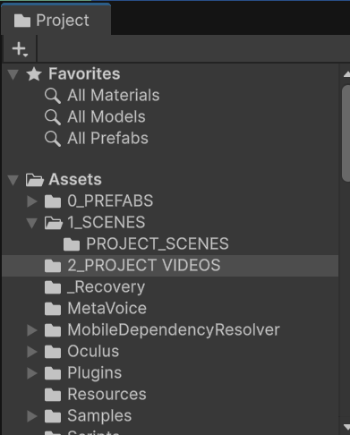
```

:::

</details>

::: {.step-result}

[✓ Expected result]{.step-result-label}

The **2_PROJECT VIDEOS** folder is selected in the Project panel.

:::

::::


:::: {.step-card}

::: {.step-header}
[1.2]{.step-number} [Import the Video Files]{.step-title}
:::

Right-click the gray area on the right side of the **Project** panel and select **Import New Asset**. Select the video files from your computer.

<details class="step-screenshot">
<summary>View screenshot</summary>

::: {.screenshot-content}

```{r}
#| label: step-1-2
#| echo: false
#| out-width: "60%"
#| fig-align: center
#| fig-cap: "Import video files into Unity"

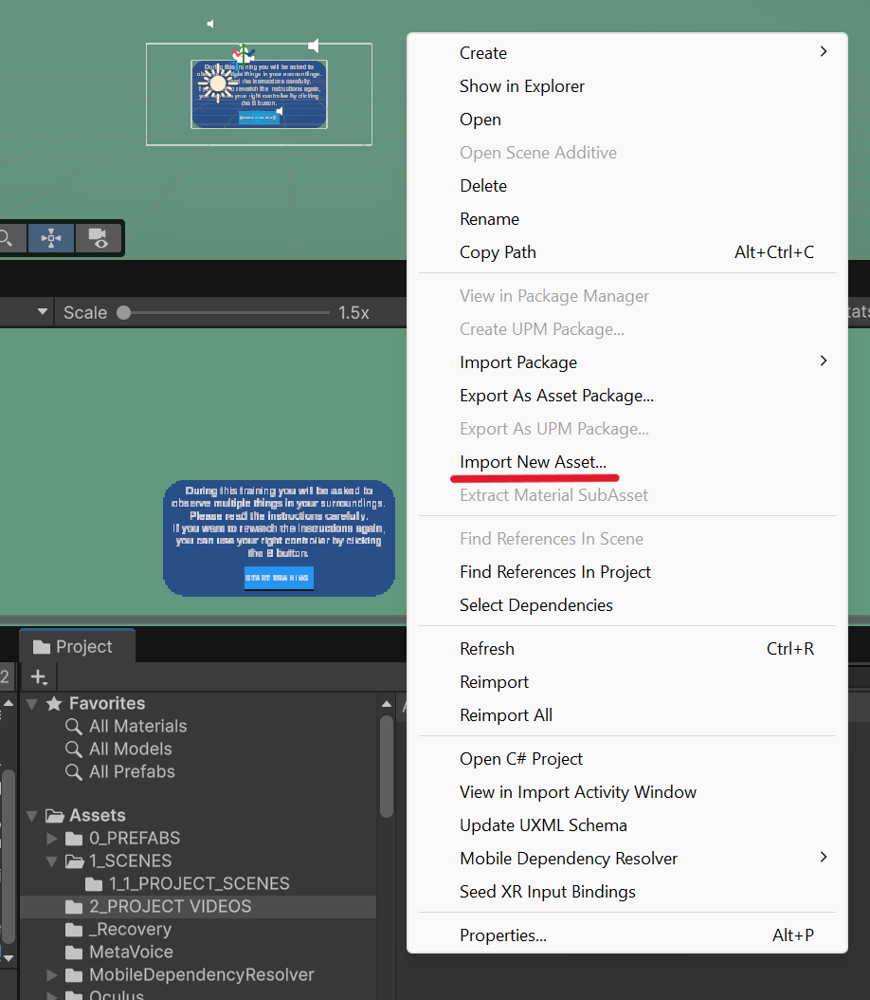
```

:::

</details>

::: {.step-result}
**✓ Expected result**

Unity begins importing the selected video files.
:::

::::


:::: {.step-card}

::: {.step-header}
[1.3]{.step-number} [Wait for the Import to Finish]{.step-title}
:::

Wait for Unity to finish importing and processing the selected video files.

::: {.step-result}
**✓ Expected result**

All selected video files have been imported into Unity.
:::

::::


:::: {.step-card}

::: {.step-header}
[1.4]{.step-number} [Rename the Videos]{.step-title}
:::

Rename each video according to its position in the training sequence.

::: {.step-tip}
**Tip:** Use short, descriptive filenames that reflect the order of the videos in your training.
:::

For example:

```text
01_video_step_1
02_video_step_2
03_video_step_2.1
```

::: {.step-result}
**✓ Expected result**

Each video has a unique and descriptive name that reflects its position in the training sequence.
:::

::::


:::: {.step-card}

::: {.step-header}
[1.5]{.step-number} [Verify the Imported Videos]{.step-title}
:::

Select the **2_PROJECT VIDEOS** folder in the **Project** panel and verify that all the videos intended for the training are present.

<details class="step-screenshot">
<summary>View screenshot</summary>

::: {.screenshot-content}

```{r}
#| label: step-1-3
#| echo: false
#| out-width: "100%"
#| fig-align: center
#| fig-cap: "Verify imported video files"

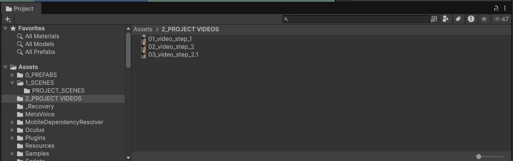
```

:::

</details>

::: {.step-result}
**✓ Expected result**

All videos intended for the training are visible in the **Project** panel.
:::

::::


:::: {.step-card}

::: {.step-header}
[1.6]{.step-number} [Save Your Progress]{.step-title}
:::

Navigate to the Unity menu bar and select:

::: {.step-path}
`File > Save`
:::

::: {.step-result}
**✓ Expected result**

Changes to the current scene have been saved.
:::

::::

---

## Step 2: Create a New Scene {-}

Create a new scene for each video in the training.

> **Important:** In this project template, each scene corresponds to one video — so the number of scenes must match the number of videos you imported. For example, if you have three videos, the training will consist of three separate scenes.

1. Locate the **Project** panel and open the following path:

<div align="center">
`Assets > 1_SCENES > 1_1_PROJECT_SCENES`
</div>

```{r}
#| label: step-2-1
#| echo: false
#| out-width: "25%"
#| fig-align: center
#| fig-cap: "Locate Scenes Path"

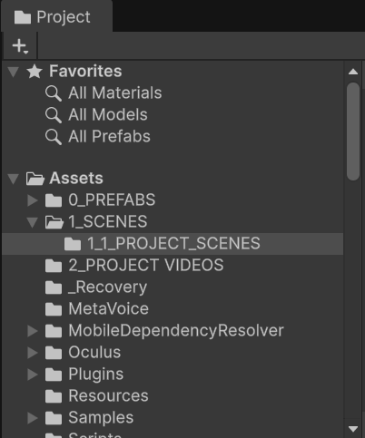
```

2. Check that you see the following pre-built scenes: `0_STARTING SCENE`, `1_FIRST_SCENE`, and `LAST SCENE` on the right side of the **Project** panel.

```{r}
#| label: step-2-2
#| echo: false
#| out-width: "100%"
#| fig-align: center
#| fig-cap: "Create Scenes"

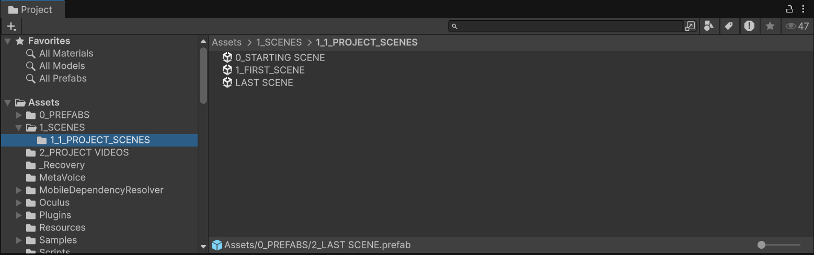
```

3. To create your first scene you will use the `1_FIRST_SCENE` as a template. Right-click in it and rename to your convenience. 

4. If you have more scenes, just copy and paste the same scene and rename accordingly

> **TIP:** Just like you did when you imported the videos, it is good practice to use a sequence number and a descriptive title to keep the scenes organized.

```text
For example:

01_scene_introduction
02_scene_demonstration
03_scene_practice
```
5. To write the content of the training instructions (e.g., In this training you will be asked to complete ...) locate the **Hierarchy** panel and open the path: 
 
<div align="center">
`SCENE START > TRAINING_INTRODUCTION`
</div>

```{r}
#| label: step-2-3
#| echo: false
#| out-width: "25%"
#| fig-align: center
#| fig-cap: "Locate Path"

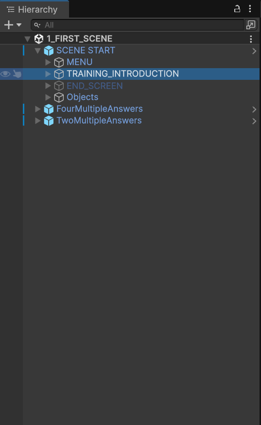
```

6. Locate the **Inspector** panel (at the right of the **Hierarchy** panel), and write the content of the instructions in the text box below the ***Header Text*** title.

```{r}
#| label: step-2-4
#| echo: false
#| out-width: "75%"
#| fig-align: center
#| fig-cap: "Write Training Instructions"

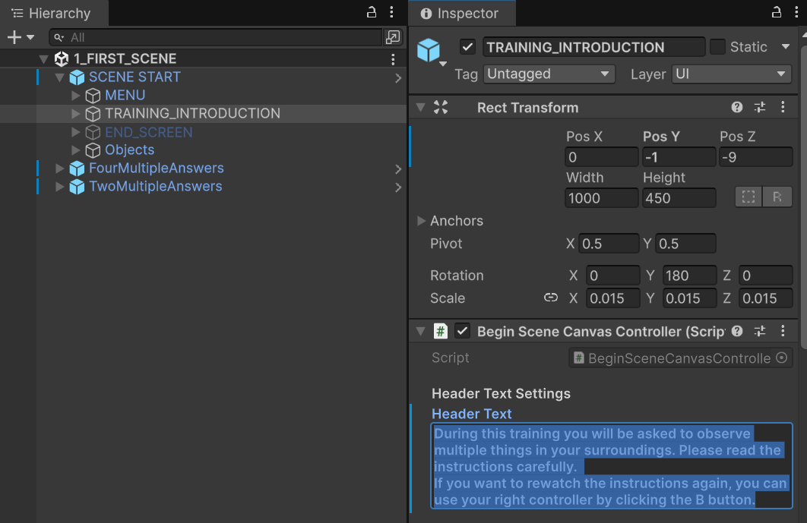
```

6. Save the progress. File > Save

---

## Step 3: Add a Video to the Scene {-}

Once you have renamed the scene, you are going to assign its corresponding video.

1. Locate the scene you want to add the video to and double-click it to open it.

> **Important:** Double-clicking is required to open a scene — a single click is not enough. To confirm a scene is open, check that its name matches the name shown at the top of the **Hierarchy** panel.

```{r}
#| label: step-3-1
#| echo: false
#| out-width: "75%"
#| fig-align: center
#| fig-cap: "Check Scene Name"

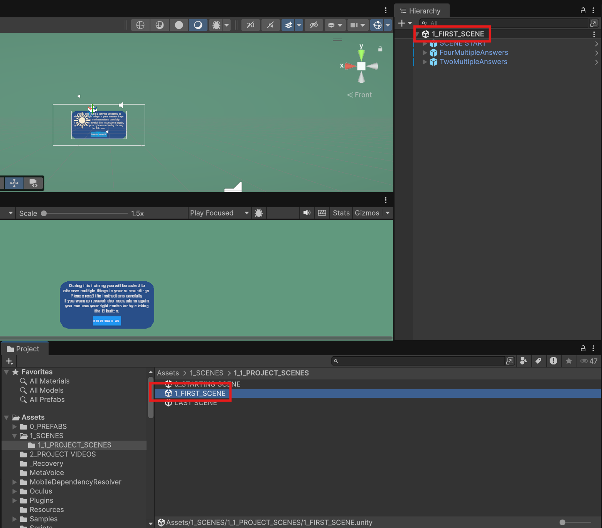
```

2. In the **Hierarchy** panel, open the following path:

<div align="center">
`SCENE START > MENU > VIDEO_PLAYER`
</div>

```{r}
#| label: step-3-2
#| echo: false
#| out-width: "25%"
#| fig-align: center
#| fig-cap: "Locate Path"

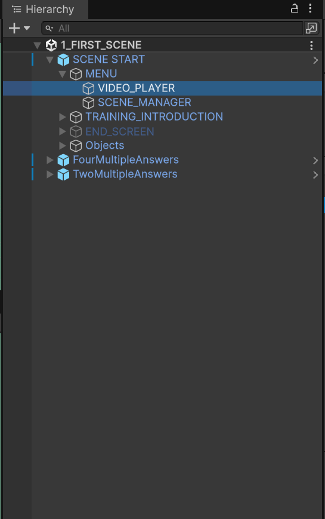
```

3. Locate the **Inspector** panel, and in the **Video Clip** sub section click in the circle icon.

```{r}
#| label: step-3-3
#| echo: false
#| out-width: "75%"
#| fig-align: center
#| fig-cap: "Upload Videos"

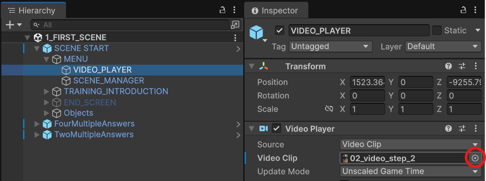
```

5. Select the video clip you want to use from the window that appears.

```{r}
#| label: step-3-4
#| echo: false
#| out-width: "25%"
#| fig-align: center
#| fig-cap: "Select Video"

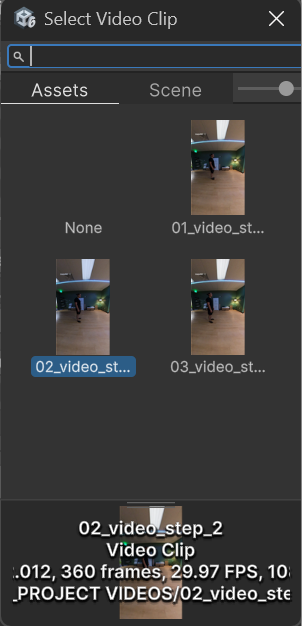
```

6. Confirm that the video appears by double-clicking on it
7. Save the progress. File > Save

---

## Step 4: Set Up the Questions {-}

In this section, you will set up the following for the scene you just created:

- The instructions for each question
- The content of each question
- The content of the multiple-choice answers
- Which answer is correct
- The correct feedback (shown when the participant answers correctly)
- The corrective feedback (shown when the participant answers incorrectly)

1. Locate the **Project** panel and open the path:

<div align="center"> 
`Assets > 0_PREFABS` 
</div>

```{r}
#| label: step-4-1
#| echo: false
#| out-width: "25%"
#| fig-align: center
#| fig-cap: "Locate Path"

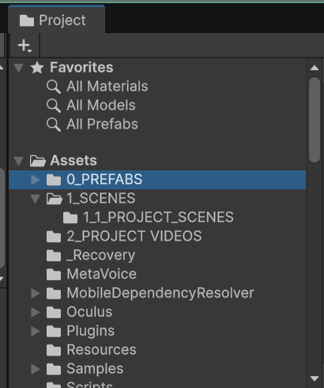
```

2. Drag one of the prefabs: **question_four_multiple_answers** or **question_four_multiple_answers** (depending on the type of question you want) into the gray area of the **Hierarchy** panel.

```{r}
#| label: step-4-2
#| echo: false
#| out-width: "75%"
#| fig-align: center
#| fig-cap: "Drag Question"

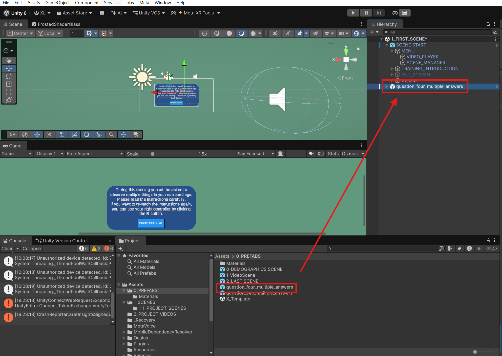
```

3. Click the question prefab, then locate the **Inspector** panel and the subsection **EDIT EVERYTHING BELOW THIS**.

```{r}
#| label: step-4-3
#| echo: false
#| out-width: "50%"
#| fig-align: center
#| fig-cap: "Edit Question Content"

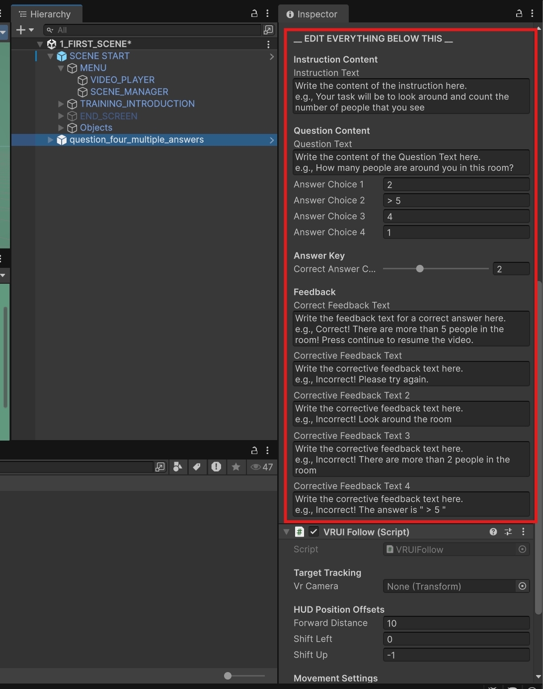
```

4. Edit the question content. See the table below for more indications.

```{r}
#| label: question-content-table
#| echo: false
#| results: asis

library(knitr)
library(kableExtra)

question_table <- data.frame(
  FIELD = c(
    "INSTRUCTION TEXT",
    "QUESTION TEXT",
    "ANSWER CHOICES",
    "CORRECT-ANSWER FEEDBACK",
    "CORRECTIVE-ANSWER FEEDBACK"
  ),
  `WHAT TO DO` = c(
    "Replace `Write the content of the instructions here`.",
    "Replace `Write the content of the question here`.",
    "Write the content of each answer in its corresponding `Answer Choice #`field.",
    "Replace `Write your correct feedback here`.",
    "Replace `Write your corrective feedback here`."
  ),
  check.names = FALSE
)

kable(
  question_table,
  format = "html",
  escape = FALSE,
  align = c("l", "l"),
  table.attr = 'class="apa-table"'
) |>
  column_spec(1, width = "30%") |>
  column_spec(2, width = "70%")
```

5. To select the correct answer, enter its corresponding number in the `Correct Answer Choice field`

In the image below, you will observe that the correct question for the answer ` How many people are around you in this room?` is `>5` that corresponds to the `Answer Choice 2` which is already selected in the answer key

```{r}
#| label: step-4-4
#| echo: false
#| out-width: "50%"
#| fig-align: center
#| fig-cap: "Choose Correct Answer"

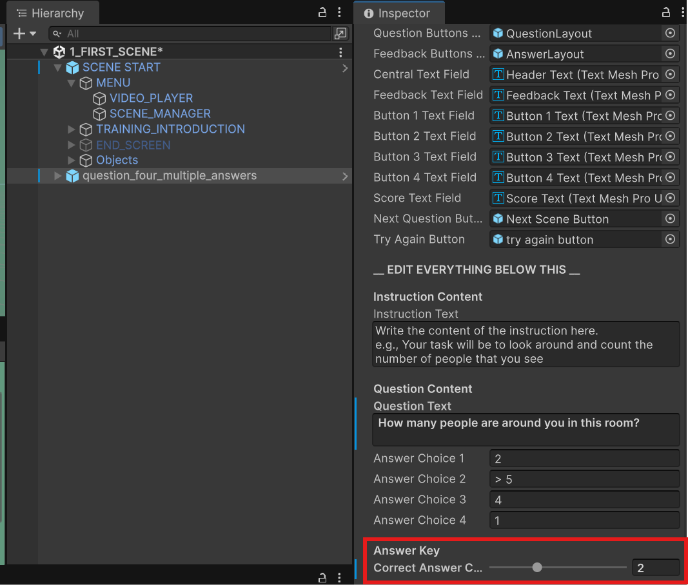
```

6. Repeat Steps 1–5 to add additional questions in the scene.

> **Note:** If you have to provide more detailed corrective feedback when the participant answers the same question incorrectly multiple times, you can enter additional feedback in the `Corrective Feedback Text 2`, `Corrective Feedback Text 3`, and `Corrective Feedback Text 4` fields. The software will show the corrective feedback 2 upon the second time the client answers wrong, and so on.

7. Save the progress. File > Save

### Step 4.1: Set up Question Order and Timing {-}

1. Locate **Hierarchy** panel and open the path

<div align="center">
`SCENE START > MENU > SCENE MANAGER`
</div>

```{r}
#| label: step-4-5
#| echo: false
#| out-width: "25%"
#| fig-align: center
#| fig-cap: "Locate Path"

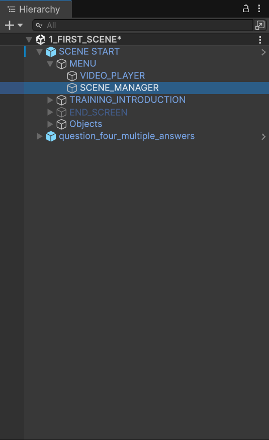
```

2. Locate the **Inspector** panel and look for the **Dynamic Sequence Setup** section.

```{r}
#| label: step-4-6
#| echo: false
#| out-width: "50%"
#| fig-align: center
#| fig-cap: "Set up Question order and timing"

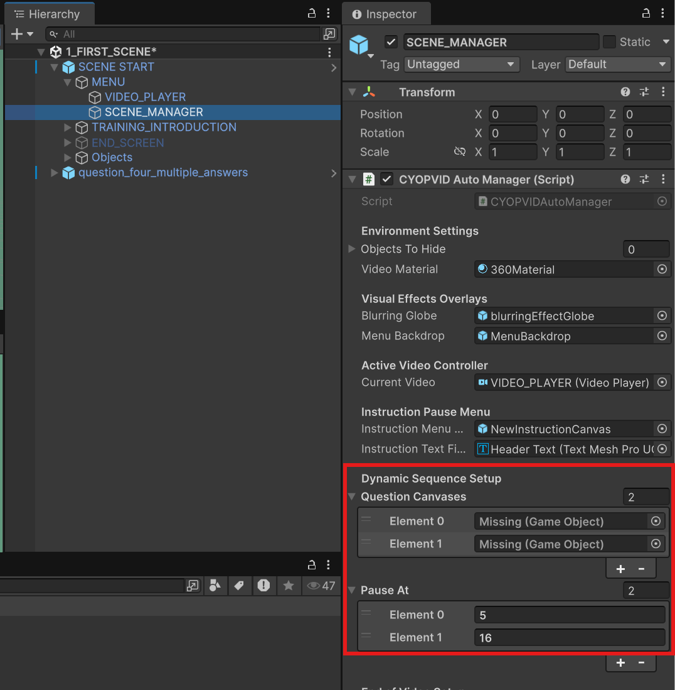
```

You will see two different panels. The **Question Canvases** and **Pause At**. The table bellow provides a description of each. 

```{r}
#| label: question-order-table
#| echo: false
#| results: asis

library(knitr)
library(kableExtra)

question_order_table <- data.frame(
  LIST = c(
    "QUESTION CANVASES",
    "PAUSE AT"
  ),
  PURPOSE = c(
    "Determines the order in which the questions are presented.",
    "Determines the time in the original video at which the question will be presented."
  ),
  check.names = FALSE
)

kable(
  question_order_table,
  format = "html",
  escape = FALSE,
  align = c("l", "l"),
  table.attr = 'class="apa-table"'
) |>
  column_spec(1, width = "30%") |>
  column_spec(2, width = "70%")
```

### Step 4.2: Configure Question Canvases {-}

#### Step 4.2.1 Configure the Questions Order {-}

1. Change the number right to **Question Canvases** to the number of questions that the scene will have. 

1. Drag the questions objects that you have from the **Hierarchy** panel to the **Question Canvases**. The order in which the question objects (e.g., question_four_multiple_answers) is displayed bellow the panel is the order in which the questions are shown in the video. 

```{r}
#| label: step-4-7
#| echo: false
#| out-width: "75%"
#| fig-align: center
#| fig-cap: "Upload Questions in Scenes"

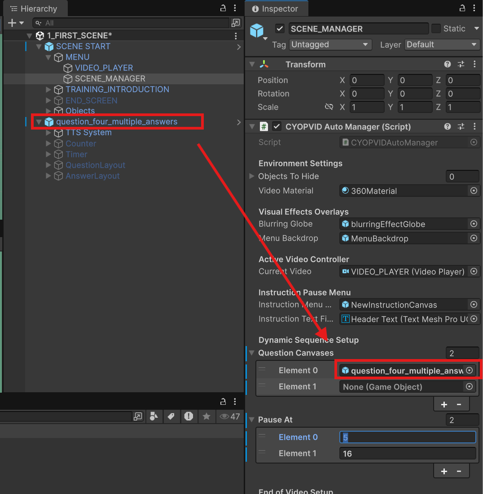
```

2. If you have more questions, drag them in their corresponding section. 

#### Step 4.2.2 Configure the Times in which the Questions will Appear {-}

1. Change the number right to **Pause At** to the number of questions that the scene will have. The **number should be the same** as the number you wrote in **Question Canvases** !.
2. Write the time in the video where the questions should appear. Take into account that the numbers are in second, and they should correspond to the seconds in the Video. If you want the question to appear in the min 2:04 you should write 124.

For example:

| Item | Will Appear |
|---:|---:|
| 0 | 60 seconds |
| 1 | 120 seconds |
| 2 | 180 seconds |

In this example, there different questions will appear at 1:00, 2:00, and 3:00 minutes. The first and last one are of four multiple answers and the second one is of two multiple answers. 

```{r}
#| label: step-4-8
#| echo: false
#| out-width: "75%"
#| fig-align: center
#| fig-cap: "Three questions for Scene"

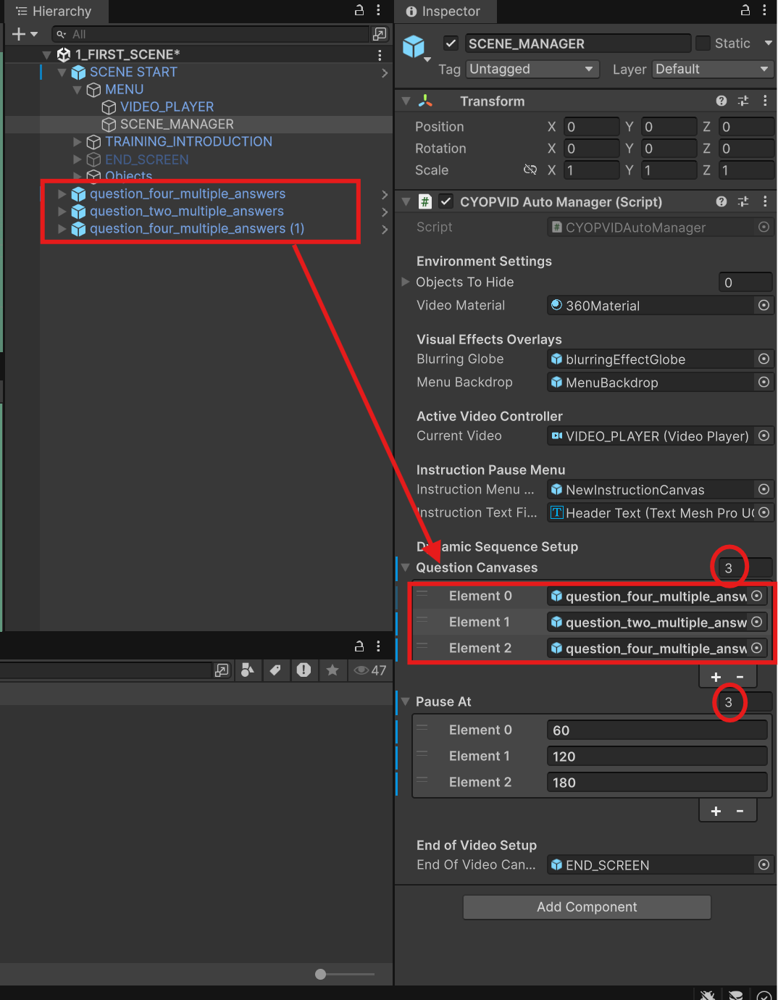
```

### Step 4.3: Verify that the scenes are connected {-}

1. In the **Project panel**, go to **Assets > 1_SCENES > 1_1_PROJECT_SCENES** and double-click the video scene you want to configure.
2. In the **Hierarchy**, expand **SCENE START** and select **END_SCREEN**.
3. In the *Inspector**, find **End Screen Scene Controller > Scene Settings > Link To Next Scene**.
4. In the Link To **Next Scene** field, enter the exact name of the scene that the Next Scene button should open. For the final video scene, enter LAST SCENE.
5. Press Ctrl+S to save.

```{r}
#| label: step-4-9
#| echo: false
#| out-width: "100%"
#| fig-align: center
#| fig-cap: "Link Scenes"

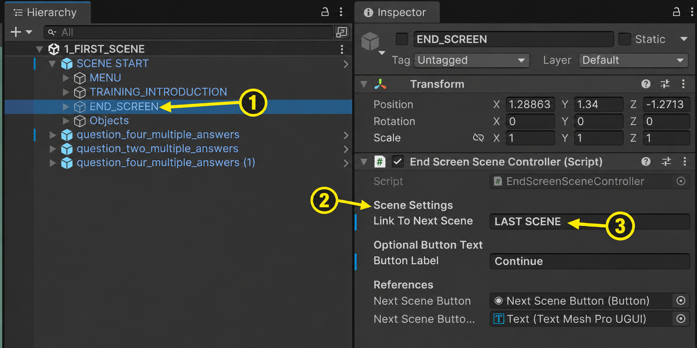
```

Expected result: After the destination scene is enabled in the build profile, pressing Next Scene on the video’s end screen opens that scene. 

---

## Step 5: Verify the Question Order {-}

Before continuing, confirm that:

- Every pause time has a corresponding question canvas.
- The pause times are arranged chronologically.
- The question canvases are arranged in the intended order.
- The number of items in both lists is identical.
- Each question is associated with the correct point in the video.

> **Warning:** Questions may appear at the wrong times when the order of the question canvases does not match the order of the pause times (Step 4.2)

---

## Step 6: Edit the Beginning Screen {-}

The beginning screen introduces the training before the video starts.

1. In the **Project** panel, double-click on **0_STARTING SCENE**

```{r}
#| label: step-6
#| echo: false
#| out-width: "100%"
#| fig-align: center
#| fig-cap: "Find Starting Scene"

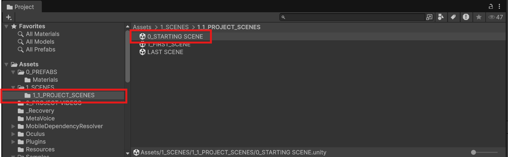
```

2. Locate **BeginSceneCanvas** in the **Hierarchy** panel and expand **Menu** the canvas to locate **Header Text**.

```{r}
#| label: step-6-1
#| echo: false
#| out-width: "50%"
#| fig-align: center
#| fig-cap: "Locate Header Text"

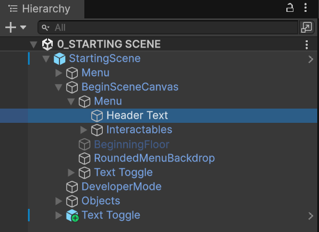
```

4. In the **Inspector** panel, find the section **TextMeshPro - Text (UI)** (you might have to scroll down) ], and replace the existing text with the introduction for your training. You can double check the text in the Scene panel

```{r}
#| label: step-6-2
#| echo: false
#| out-width: "100%"
#| fig-align: center
#| fig-cap: "Change Training Title"

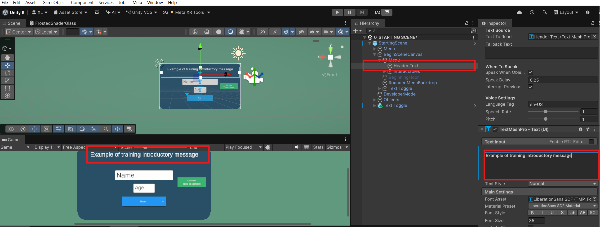
```

For example:

> Welcome to the caregiver training. In this module, you will observe a caregiver responding to a child during a daily routine.


> **Tip:** Keep the introduction brief, easy to read, relevant and consistent with the purpose of the training. 

5. Save the scene.

---

## Step 7: Check the End Screen {-}

Check the destination you set in Step 4.3 for each video scene.

1. In the **Project** panel, double-click the video scene you want to check.
2. In the **Hierarchy**, expand `SCENE START` and select `END_SCREEN`.
3. In the **Inspector**, find **End Screen Scene Controller > Scene Settings > Link To Next Scene**. Enter the exact name of the next scene, without the `.unity` extension. For the final video scene, enter `LAST SCENE`.
4. If you made a change, press **Ctrl+S** to save.

```{r}
#| label: step-7-end-screen
#| echo: false
#| out-width: "100%"
#| fig-align: center
#| fig-cap: "Select END_SCREEN, find Scene Settings, and check Link To Next Scene"

knitr::include_graphics("images/step-7-end-screen.png")
```

::: {.step-result}

**✓ Expected result**

**Link To Next Scene** displays the destination. The learner presses the end-screen button to open it. The button reads **Continue** in this example.

:::

---

## Step 8: Add the Scene to the Build Profile {-}

Add each new video scene to the **Scene List** used by your active build profile.

1. In the **Project** panel, double-click the new video scene to open it.
2. Go to **File > Build Profiles**.
3. Select the active platform or profile and click **Open Scene List**.

```{r}
#| label: step-8-open-scene-list
#| echo: false
#| out-width: "90%"
#| fig-align: center
#| fig-cap: "Click Open Scene List in Build Profiles"

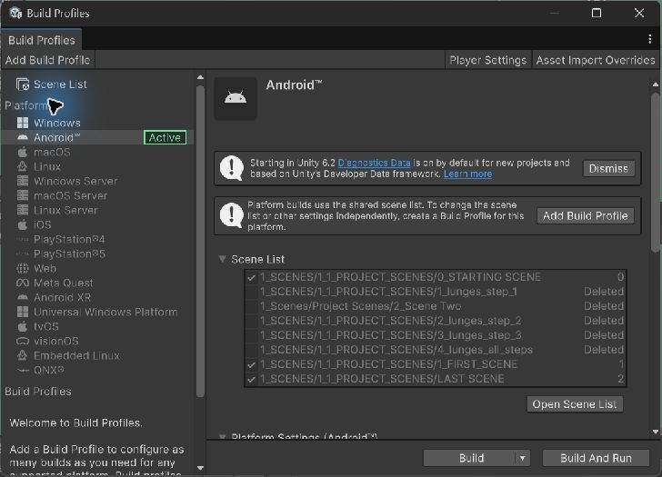
```

4. If the scene is missing from the list, click **Add Open Scenes**.
5. Confirm that its checkbox is selected. Check that `0_STARTING SCENE`, every video scene used in your training, and `LAST SCENE` are enabled.

```{r}
#| label: step-8-enabled-scenes
#| echo: false
#| out-width: "90%"
#| fig-align: center
#| fig-cap: "Use Add Open Scenes, then check that each required scene is enabled"

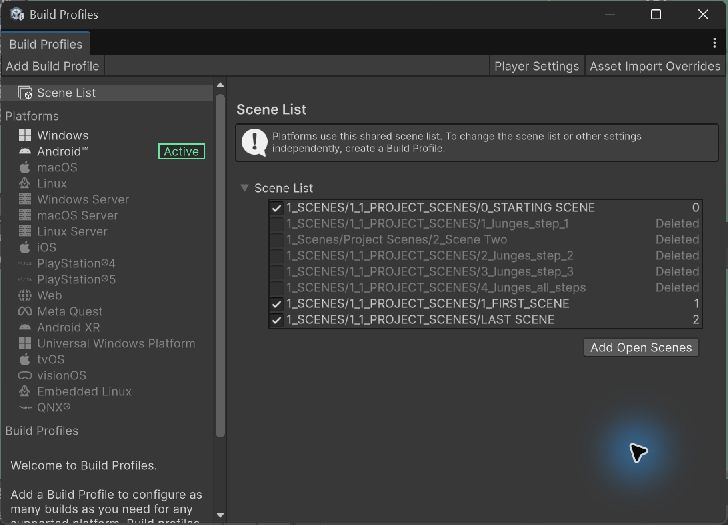
```

::: {.step-result}

**✓ Expected result**

Every scene in the training flow has a checked box in the active **Scene List**. The example shows the three enabled template scenes.

:::

> **Test the connection:** Close **Build Profiles**, open `0_STARTING SCENE`, and enter **Play** mode. Follow the training and press the end-screen button after each video. Confirm that each button opens the intended scene and that the final video leads to `LAST SCENE`.


---

## Step 9: Save the Scene {-}

Save the scene after making any changes by pressing:

```text
Ctrl + S
```

You should save the scene after:

- Assigning a video
- Changing question timestamps
- Adding question canvases
- Editing the beginning screen
- Editing the end screen
- Adding the scene to the build profile

---

## Step 10 - Scene Configuration Checklist {-}

Before moving to the next scene, confirm that:

- [ ] The scene has a clear and unique name.
- [ ] The correct video has been assigned.
- [ ] The video plays correctly.
- [ ] The number of pause times matches the number of questions.
- [ ] Each question canvas is in the correct position.
- [ ] The beginning-screen text has been updated.
- [ ] The next-scene name has been entered correctly.
- [ ] The scene has been added to the build profile.
- [ ] The scene has been saved.

After completing this checklist, repeat the process for the next video in the training.